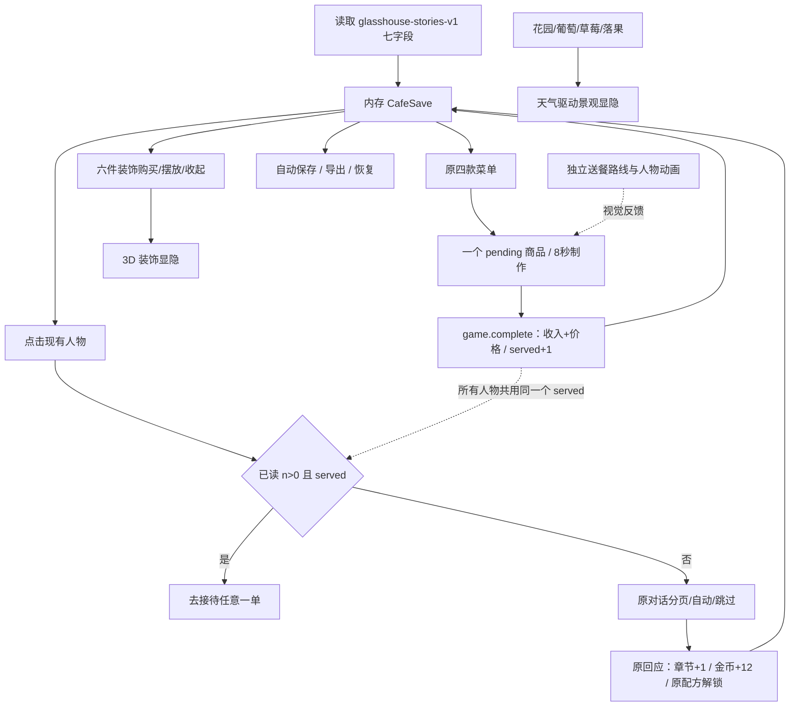

# 《玻璃间》核心玩法闭环分阶段执行计划

审计日期：2026-11-16  
当前执行批次：阶段3「经营经济与目标引导」。下方 P0—P6 是最初审计时的工程拆分编号，不等于用户当前的阶段授权。  
工作目录：`/Users/rg/Documents/ChatGPT/Toolkit Developer/输出/玻璃间-庭院天气版`。

## 阶段3：经营经济与目标引导（2026-11-16）

**状态：已完成并验收通过；阶段3结束，不开始后续阶段，未发布、未推送。**前两阶段完成记录继续保留为历史验收，不把其“未开始阶段3”理解为当前状态。

依赖：已读取产品规格及阶段1/2记录，保留阶段1委托/订单事务与阶段2作物/库存协议。本阶段没有新存档字段：小费由六个常规装饰ID的 owned∩placed 派生，完成订单时计算。

实施顺序：

1. `app/src/progression.ts`：小费0—6、购买/摆放纯规则、一次性分项结算、非负/溢出事务保护、同源目标优先级。
2. `app/src/game.ts`：菜单/装扮的小费说明；订单收益+委托+作物提醒合成一次通知；沿用原卡片与价格。
3. `app/src/main.ts`、`game.css`：原提示容器的关键消息排队、多行和原生弹窗顶层保护；不改场景、镜头、天气或制作时长。
4. 新增 `verification/economy-progression.cjs`、`economy-playtest.cjs`、`stage3-regression.cjs`；更新既有委托/花园测试中仅商品收益的历史预期。
5. `docs/GAMEPLAY-CLOSURE-STAGE3-RESULTS.md` 记录经济模拟、测试证据与边界；生产构建更新 `game/`、`dist/`，不发布。

验收：

- 六件常规装饰已买且摆放每件+1、最多6；重复ID、未买/收起、免费冬季装饰不计。
- 完成时才结算，收益/小费独立可读；同次委托和作物提示不覆盖；重复完成零收益。
- 引导严格按新故事→人物委托→首件装饰→棠姨线→花园收获/照料/播种/生长→自由营业；不为强推花园或装饰改变优先级。
- 旧档不补发小费，不修改已得金币；价格、故事12金币、作物产量与消耗不变。
- 纯规则覆盖4096种拥有/摆放组合、六款商品×七档小费、非法数值、经济路径；桌面与390px真实订单验证。

验证命令：

```sh
node verification/quest-progression.cjs
node verification/garden-progression.cjs
node verification/economy-progression.cjs
npx tsc --noEmit
npm run build
BASE_URL=http://127.0.0.1:5194 node verification/economy-playtest.cjs
BASE_URL=http://127.0.0.1:5194 node verification/stage3-regression.cjs
```

明确非目标：新货币、等级、体力、失败惩罚、新NPC、菜单重设计、配方调价、场景重构、发布或推送。验收通过即停止，不扩展下一阶段。

共享目录确认：用户已确认采用另一轮完成的新人物手记（卡片只展示、场景NPC仍可点击）。不恢复旧卡片按钮；增加 `verification/character-interaction.cjs`，将既有人物/对话/冬季/花园测试改为真实3D热点点击，手机测试检查新版三张卡。最终验收使用该稳定版本。

完成记录：[GAMEPLAY-CLOSURE-STAGE3-RESULTS.md](GAMEPLAY-CLOSURE-STAGE3-RESULTS.md)。五组现有生产回归与新增经营浏览器测试全部通过，最终构建及源码摘要见 `verification/economy/`。

## 前两阶段历史记录

## 本次执行范围与状态（2026-11-16）

### 阶段2：花园种植闭环

**状态：已完成并验收通过。阶段2结束；不开始阶段3，未发布、未推送。**按本轮授权复用阶段1委托/订单事件，只新增花园权限、播种/成长/照料/收获、库存、两款限定新品和两处3D热点。禁止装饰小费，不开始阶段3。

依赖：先复核阶段1规则、256组迁移和端到端订单；随后扩展 progression.ts，接 game.ts UI/事件，最后 garden-fruit.ts 分组显隐、garden.ts/main.ts 热点桥接。菜单原四卡、价格、图片保留，仅追加两卡；现有菜单骨架不变。

实现约定：每轮两单进入待照料，浇水后再完成一单成熟；未照料不储存额外进度；每次收获+3。新品在完成订单时扣1食材，刷新中止订单不丢食材。任何正常订单（包括错单/新品）推进所有已播种作物。雪天经营状态保持、果实沿用休眠视觉。旧档及阶段1档棠姨已读3章自动开放花园，不发奖励。

实际实施范围（另含下述构建修正）：app/src/progression.ts、game.ts、game.css、garden-fruit.ts、garden.ts、main.ts；verification/garden-*测试及既有回归的过时断言；规格/计划/完成记录；构建产物game/和dist/。

生产回归发现原 CSS 压缩会丢弃对话框标准 backdrop-filter，仅保留前缀版本。新增最小构建修正：vite.config.ts 的 cssMinify=false，保留原样式，JS 压缩不变；dialogue.ts/css 原文件未修改。原 winter-playtest 的棠姨历史坐标已过时，改为与本轮启动时位置比较，验证天气往返不挪人。

验收：种植规则与库存防重纯测试；真实8秒订单驱动两个作物循环；两热点打开同一面板；导入/刷新/导出往返；晴雨雪成熟显隐；对话、委托、冬季和手机现有回归；TS与生产构建。五组生产浏览器回归、10组花园纯规则、17组委托检查（含256组迁移）、TypeScript和生产构建全部通过。详细证据见 [GAMEPLAY-CLOSURE-STAGE2-RESULTS.md](GAMEPLAY-CLOSURE-STAGE2-RESULTS.md)。到此停止。

### 阶段1：人物委托闭环

**状态：已完成并验收通过；在阶段1停止。未开始阶段2，未发布、未推送。**

用户本次明确授权端到端完成人物委托，范围覆盖原 P1 的相关内容冻结、P2 的人物规则/迁移、P3 的人物/菜单/订单接线，以及相关 P6 验证。**不包含原 P2/P3 中的作物、小费或新品内容；未授权进入阶段2。** 下方初始审计和未来整体计划保留为历史与长期依赖，不作为本次扩大范围的许可。

本阶段源码实际改动：

- 新增 `app/src/progression.ts`：六项委托、章节资格、旧档迁移、原子订单、下一件小事；不含 Three.js/DOM。
- 修改 `app/src/game.ts`：人物卡四状态、准确门槛、菜单最多三项委托/交付对象、存档兼容及在制/异步导入保护、订单完成反馈。
- 修改 `app/src/game.css`：委托轻量标签和 390px 换行；恢复原有「下一件小事」入口的可见性。
- 修改 `app/src/main.ts`：仅把所选商品名传入原制作提示；8 秒流程、帧循环、送餐、镜头不变。
- 新增 `verification/quest-progression.cjs`、`verification/quest-playtest.cjs`、`verification/fixtures/quest-locked.json` 及测试结果/截图；原 `dialogue-playtest.cjs` 仅更新门槛预期、BASE_URL 与原生 close 事件等待。
- 构建生成 `game/` 和既有构建脚本的 `dist/` 镜像；不手改产物。

本阶段状态模型：`characterQuests?: { version: 1, entries, legacyGateCredits }`。entries 中每个任务是 active/completed，完成来源为 order/legacy；不存在的任务为未触发。运行时订单固定 recipe/target，committed 与 pending 双重防重，不写入存档。`orderEpoch` 只用于阻止异步恢复覆盖新订单。

迁移：七个旧字段逐值保留；仅在缺少 characterQuests 时读取旧 served 推断资格；历史章节和未来门槛豁免均保留。进入新版后，served 只计订单数，不能解锁人物。保留原 localStorage key 和导出格式。未知未来版本不覆盖原存储，非法导入不改变当前进度。

产品规则落实：同款多个委托需选一位对象或自由营业；只有一个匹配委托时默认匹配。手动指定对象后做错商品，只售卖、不转给别人。故事仍 +12，委托不另发金币，商品仅按原价格结算。

验收命令（均在项目根目录）：

```sh
node verification/quest-progression.cjs
BASE_URL=http://127.0.0.1:5193 node verification/dialogue-playtest.cjs
npx tsc --noEmit
npm run build
npm run preview -- --port 5194 --strictPort
BASE_URL=http://127.0.0.1:5194 node verification/quest-playtest.cjs
```

所有浏览器测试使用独立上下文与合成测试存档，不读取玩家会话。Playwright 使用已安装运行时；新测试支持 `PLAYWRIGHT_MODULE` 显式路径或标准安装模块。

验收证据汇总见 [GAMEPLAY-CLOSURE-STAGE1-RESULTS.md](GAMEPLAY-CLOSURE-STAGE1-RESULTS.md)。

### 阶段1停止时的后续工作清单（历史记录，现以阶段2状态为准）

- 阶段2及后续：花园权限/经营/播种/照料/收获、模型成熟显隐、食材库存和两款限定新品。
- 装饰氛围小费尚未开始；摆放六件常规装饰仍不改变原订单收入。
- gardenUnlocked、gardenState、ingredients、gardenRecipes 的初始化与迁移留待对应阶段；本阶段仅对已有不相关扩展字段做保留，不创建这些字段。
- 花园成长节奏、库存扣除时点等剩余产品决策保留待确认。
- 未部署、未推送；完成阶段1后停止。

## 1. 源码入口和初始审计基线（P0 历史记录）

### 1.1 已阅读文件

- `package.json`、`vite.config.ts`、`tsconfig.json`、构建后处理 `scripts/stage-courtyard.mjs`。
- `app/src/game.ts`、`main.ts`、`dialogue.ts`、`garden.ts`、`garden-fruit.ts`、`world.ts`。
- 补充核对 `app/src/game.css`、`indoor-look.ts`、`winter-patio.ts`、`app/index.html` 与项目说明。
- `verification/` 中现有 11 个 `.cjs` 脚本，见第 2 节清单。

| 项目 | 事实与实施影响 |
|---|---|
| 依赖 | Three.js 与 types `0.187.0`，TypeScript `7.0.2`，Vite `8.3.8` |
| 开发入口 | Vite root=`app`，TS include=`app/src`；根目录旧 `src/` 不参与当前开发 |
| 构建 | `npm run build` = `tsc --noEmit && vite build && node scripts/stage-courtyard.mjs` |
| 产物 | Vite 清空并生成 `game/`；后处理复制根入口和 game 到 `dist/`，所以构建会改动两处产物 |
| 开发地址 | 配置为 `127.0.0.1:5193`；本阶段没有确认当前监听进程属于此目录，不用浏览器 URL 证明源码版本 |
| 测试入口 | 没有 npm test 脚本；现有脚本使用 Node assert 和 Playwright |
| 依赖安装 | 本项目目录没有 `node_modules/`，有 `package-lock.json`；不在规划阶段安装依赖 |

### 1.2 当前系统状态图



实际审计发现：

1. `game.ts:7–17` 定义 CafeSave、key、四配方、九章原文、六装饰、读档。原数据常量必须冻结，不能靠新文案代替旧故事。
2. `game.ts:25–35` 的 next-step、people、talk 共用 served 门槛。仅换人物卡文案不够，真正的可读性、点击动作和章节回应必须共用规则。
3. `game.ts:38–44` 选择商品、制作、导入导出；末尾 complete 只知道 recipe，没有 NPC 目标。必须把目标放在运行时订单快照中，不能在结束时查「现在谁需要它」。
4. `main.ts` 是现有 8 秒计时和 complete 回调的桥接点。送餐路线自身并不带 NPC 委托语义；此迭代不调整路线、动画时长或相机。
5. `dialogue.ts` 已处理按字数/宽度分页、自动计时、跳过、清理、一次回应提交；保留文件可降低最常见的回归风险。
6. `garden-fruit.ts` 将葡萄、草莓、落果放入共同 berries 组并合批；必须在合批之前按作物分组，才能独立成熟。天气 update 的缓存不能阻止一次作物状态更新。
7. `garden.ts` 根节点旋转 π/2 并平移到 `(-14.3,0,3.95)`，热点应随模型变换，不根据概念图方位重置花园。
8. `world.ts` 导出 Hotspot 类型，但创建 hit 的帮助函数在 buildWorld 内部；优先由 garden 返回自己的热点/锚点，再由 main 接线，不为两块种植地改整个 world。
9. 存档导入有一次异步文件读取；当前仅读取前判断 pending。未来必须在提交前复查，避免旧/新进度覆盖正在结算的订单。
10. 运行时启动会调用 persist；浏览器验证不能使用用户正在游玩的上下文。本阶段未打开应用进行测试。

## 2. 既有 verification 审计

### 2.1 覆盖与不适用项

| 现有脚本 | 覆盖范围 | 后续处理 |
|---|---|---|
| dialogue-playtest.cjs | 首章正文、12 金币、honey 解锁、自动、跳过、归档、390px、音乐、订单 | 保留原用例；旧「接待一单」门槛断言需按本次需求更新；扩展全九章锁定与委托 |
| decor-thumbnails.cjs | 六小图/面板文字/布局、收起收益不变、390px | 依赖 `decor-before.json`，当前缺失；在未实施版本采集受控 baseline 后使用，不能空跑声称通过 |
| animation-fixes.cjs | 桌椅朝向、柜台/壶间距、招牌、伞、送餐、手机画幅 | 固定 7 椅、旧服务坐标/相位等历史断言需与当前资产核对，不能为通过测试把场景改回旧版 |
| animation-geometry.cjs | 无 WebGL 的壶握持、台面净距、服务路线采样、招牌 | 加载真实源码的检查可保留；旧路线包围条件需基线核对 |
| room-playtest.cjs | 环视/坐下、音乐、雪天林伯、室内人物入口 | 硬编码站立 `[0,2.4,-.335]`，而当前 indoor-look 已采用门口入内机位；应校准测试而非恢复旧机位 |
| room-touch.cjs | 844×390 触控定点环视、雪天对话 | 保留；新增 390px 竖屏经营面板验收另列 |
| winter-playtest.cjs | 5000 雪粒、灯串、冬日独立摆件、天气往返、音乐/订单/对话 | 棠姨历史站位断言已不适配现有花园；依据当前资产冻结，不移回旧座位 |
| patio-playtest.cjs | 冬态桌椅、积雪法线、可逆天气、小毯开关、室内/手机 | 仍期待两把翻扣椅，但当前版本已移除；记为过时测试条件，不能重建被用户删除的椅子 |
| winter-clearance.cjs | 冬日摆件位置与服务路线净距、门花环、天气还原 | 保留碰撞约束，复核与当前角色/路线的数据契约 |
| island-playtest.cjs | 近景初始视角、全岛、33 木板、游船状态、天气/潮位/缩放、手机降级 | 锁定系统回归，游戏进度不能被天气/镜头操作改变 |
| island-geometry.cjs | 实际船体与海床、浮体角度、游客鞋底/舷梯/木道，quick/full 采样 | 独立既有几何检查，不属于玩法实现；最终按风险运行 quick，相关疑点才扩展 full |

结论：现有脚本没有专属委托、经营作物、新品库存、迁移豁免或氛围小费覆盖。旧脚本文件存在不等于当前可通过。本阶段仅阅读，没有运行这些测试，旧 JSON/截图不作为此次结果。

### 2.2 执行前需要校准的环境

- 多个浏览器脚本写死本机 Playwright 绝对路径和 `http://127.0.0.1:5193/?qa=1`，不具备仓库即装即跑的可移植性。
- 几何脚本使用 `node:module.stripTypeScriptTypes`；Node 须同时满足锁定 Vite 的 engines 与此 API。后续记录实际 Node/npm/Chrome 版本，不凭当前 shell 推断。
- 测试会写 verification 截图/JSON，有的写临时编译文件；不能在当前只读阶段执行。
- P1 建议用小型测试帮助模块统一 `BASE_URL` 与 Playwright 解析：优先标准安装模块，支持显式环境路径，记录实际使用值；不增加应用框架，不将测试依赖打进 game。
- 若 5193 被另一项目使用，启动本目录的隔离端口并设置 BASE_URL；不终止用户正在运行的服务。以入口响应与目标构建标识核实服务器，不能仅看到标题就认定正确版本。
- 新建独立 BrowserContext/明确测试存档，禁止借用用户现有浏览器存档。测试导入仅导入 fixtures。

## 3. 锁定清单与最小文件改动表

完整锁定要求见 SPEC §3 和附录 A。本计划不拆出新 NPC、故事文本包或渲染子系统，不进行格式化全文件、命名大迁移或依赖升级。

| 文件 | 预计变动 | 原因/限制 |
|---|---|---|
| **新** app/src/progression.ts | 纯规则、类型、迁移、派生状态、事务 | 集中任务/作物/库存，零 Three.js/DOM 依赖 |
| app/src/game.ts | 可选存档扩展、人物状态、菜单委托、新品、花园面板、小费、引导 | 四配方/九故事/六装饰常量保持；只在菜单末尾拼接新增配方 |
| app/src/game.css | scoped 委托/库存/花园卡和解锁后导航适配 | 不改对话水彩组件、装饰小图内部、原面板骨架 |
| app/src/garden-fruit.ts | 葡萄/草莓成熟组、落果归属、两处锚点、经营视觉刷新 | 保留几何、材质、坐标、冬季视觉；不存业务状态 |
| app/src/garden.ts | 暴露成熟显隐入口与局部热点 | 不移动花园/棠姨/猫/道具，不改草坪 |
| app/src/main.ts | 注册热点、传递权限/视觉快照、订单桥接、QA 快照扩展 | 不改相机、场景初始化与天气/海岛更新算法，不把规则堆入帧循环 |
| **新/小改** verification/ | 规则测试、迁移 fixtures、端到端、基线与旧测试校准 | 使用已有 Node assert/Playwright，不新增测试框架 |
| docs/ 两份文档 | 确认决策后更新状态与证据 | 长期产品规格 |
| game/、dist/ | 最终阶段仅由构建生成 | 不手改构建文件；避免将过期产物当最新 |

原则上**不改**：`dialogue.ts`、`dialogue.css`、`world.ts`、`delivery.ts`、`indoor-look.ts`、`music.ts`、`garden-lawn.ts`、`island*.ts`、天气/雨雪/室内渲染模块、现有美术资源、`app/index.html`、根旧 `src/`、package/Vite/TS 配置。若实施时发现非改不可，应说明具体调用依赖并先更新计划，不能因范围扩大顺手重构。

只需一个新 progression 模块，暂不同时新增第二个 garden 状态框架。订单、作物与 UI 的边界通过事件/数据快照连接。

## 4. 游戏状态契约与状态机

### 4.1 事件边界

| 事件 | 纯规则输入 | 允许产生的变化 |
|---|---|---|
| 首次章节回应 | personId、expectedChapter、当前存档 | 只推进该章一次、原 +12/原菜品、当前委托或棠姨花园权限 |
| 开始订单 | recipeId、可选 targetQuestId、当前存档 | 验证后生成运行时订单；不产生收益/生长 |
| 完成订单 | 固定订单快照、当前存档 | 一次扣料/收益/served/一个委托/两作物生长 |
| 播种 | cropId、权限、当前作物 | unsown → sown |
| 照料 | cropId、权限、当前作物 | needs-care → growing(cared) |
| 收获 | cropId、权限、当前作物 | ready → unsown，+3，首次新品 |
| 购买/摆放/收起 | 原 decor ID、当前存档 | 原逻辑；小费由派生值自动改变 |
| 读档/恢复 | 未信任的 JSON 数据 | 候选规范化/迁移/验证，成功后一次提交 |
| 天气/镜头变化 | 纯视觉状态 | 不改变经营状态或库存 |

章节回应须验证 expectedChapter，不能仅依赖 UI 组件 committed；重复监听或陈旧窗口回调也不得领奖。订单以 runtime transaction ID + pending 状态防重，不把 ID 当新货币或展示给玩家。

### 4.2 人物委托状态表

| 人物 | 首章后 | 第二章后 | 第三章后 |
|---|---|---|---|
| 阿禾 | honey 1 → 第二章；仍在首章解锁 honey | tea 1 → 第三章；仍在第二章解锁 tea | 原归档 |
| 林伯 | pour 1 → 第二章 | berry 1 → 第三章；仍在第二章解锁 berry | 原归档 |
| 棠姨 | pour 1 → 第二章 | tea 1 → 第三章；仍在第二章解锁 tea | 原归档 + 花园经营 |

状态：未触发 → 原回应后 active → 正确且指定此目标的订单 completed → 下一章可读。错误商品、其他人物委托完成和 served 增加不改变该任务。已完成任务不会因重播剧情、刷新或追加订单重新激活。

旧存档的 completed/未来豁免可来自 legacy 证据，永不支付额外奖励；新玩家只由实际目标订单推进。

### 4.3 花园状态机

建议阈值经 D2 确认后实施：

```text
未播种
  --播种--> 已播种(0)
  --第1单--> 生长中(1)
  --第2单--> 待照料(2，额外订单不囤积)
  --点击浇水--> 生长中(2，已照料)
  --第3单--> 可收获(3)
  --收获--> 对应库存+3、首次解锁新品、回到未播种
```

所有订单共同照顾两种已播种作物；作物之间独立。雪天隐藏成熟果实只影响显示，不替换/重置 stage。`garden-fruit.ts` 接收派生的 `{grapeRipe, strawberryRipe, cultivationEnabled}`，与天气共同决定最终 visible，渲染层不能自己发食材。

## 5. 存档迁移方案

详细算法与案例在 SPEC §9。实施前先冻结合法旧 fixtures，后写迁移纯函数，最后接 UI，避免边写存档边试验。

1. 原 key `glasshouse-stories-v1` 和导出包装 `glasshouse-v1` 保持。
2. 新增五个可选字段：characterQuests、gardenUnlocked、gardenState、ingredients、gardenRecipes；对象中缺少一个新增字段不能令七字段基础进度归零。
3. 原 coins、earned、chapters、recipes、owned、placed、served 对有效旧数据逐值保留，绝不重发 +12，绝不自动收录未读章。
4. 每位人物第一门槛按 `c>=2 || s>=1`，第二门槛按 `c>=3 || s>=2` 推断；未读到的豁免也存下来，以免在将来回应后锁回。
5. 已读章节是不可回滚事实；当前未满足门槛才转为 active 专属委托。迁移标记写入 characterQuests，之后 served 不再推断任务。
6. 棠姨已读 3 章自动解锁花园，其他新数据安全默认；已有扩展存档逐字段验证保留。
7. 规范化幂等：`migrate(migrate(save))` 等价；import→export→import 业务状态相同。新字段不合法局部修复，核心旧数据不丢；不支持的未来 schema 给出恢复提示而非覆盖。
8. 导入前、异步读文件后都检查无在制订单；所有验证通过才替换并保存。无效文件不修改当前内存或 localStorage。
9. 新品 ID 单存 gardenRecipes，不混进原 recipes，原四配方校验和兼容范围清楚。单个作物记录损坏不拖累另一作物或原章节。

必要 fixture 组合：新游戏；c=0/1/2/3 × s=0/1/2/较大值；三人不同进度；全收录；Tang3；旧全装饰/收起；同款双委托；单个新字段缺失；部分新字段无效；新版 active/completed；两作物不同阶段；已解锁但无食材；无效 JSON/非法核心字段；在制中导入。

纯数据测试须检查完整七字段投影 deepEqual，而不只看 coins 或 chapters。迁移后的首次回应与首次订单也要测试，以覆盖「未来门槛」问题。

## 6. 阶段依赖与交付门槛


下列命令均为**后续阶段计划**，并非本阶段已运行。命令在项目根目录执行；新增测试文件名是计划路径，当前尚不存在。

### P0 · 本阶段：审计与规划

- 修改文件：仅 docs 两份文档。
- 完成条件：当前系统图、最小文件表、迁移规则、六项委托、花园状态机和产品决策已写明；九章原文、四配方、六装饰有冻结依据。
- 验证：文档链接存在、原文与源码逐字比对、文件范围哈希复核。不开浏览器，不导入存档，不运行 build。
- 输出后停止；不把长篇产品规格解释为本阶段授权实施。

### P1 · 实施前基线与测试环境

- 依赖：D1—D4 确认，用户进入实施阶段。
- 预计文件：`verification/helpers.cjs`、`verification/fixtures/gameplay-locked.json`、`verification/locked-content.cjs`；确有过时断言的既有测试；两文档决策/证据记录。
- 工作：核实目标服务、Node/依赖；在原版读取九章/原配方/装饰/图片摘要形成 fixture；捕获缺失装饰 baseline；用独立测试上下文记录现有镜头/天气/送餐基准。
- 不为符合老测试修改当前场景；基线修订应注明源码事实、历史需求与旧断言冲突，保留检查意图，不能删除真正失败的功能断言。
- 验证命令：

```sh
npm ci
npx tsc --noEmit
npm run dev -- --port 5194 --strictPort
```

服务在独立终端运行，校准后的脚本支持 BASE_URL：

```sh
node verification/locked-content.cjs
BASE_URL=http://127.0.0.1:5194 node verification/decor-thumbnails.cjs before
BASE_URL=http://127.0.0.1:5194 node verification/dialogue-playtest.cjs
```

- 门槛：有可信当前基线；环境不可用或发现真实既有缺陷时记录阻塞/范围，不伪造 PASS，也不顺手扩展本次需求。

### P2 · 纯数据规则与兼容迁移

- 预计文件：新 `app/src/progression.ts`、新 `verification/progression-unit.cjs`、新 `verification/migration-unit.cjs`、`verification/fixtures/legacy-*.json`/`extended-*.json`。
- 工作：六委托定义、章节资格、状态转换、成长/收获/库存规则、原子结算、小费、目标引导；迁移版本和未来门槛豁免。先不接应用，不触碰用户存档。
- 验收：错误商品不完成委托；双同款目标只完成一个；重复事件无变化；旧七字段完整保留；高 served 未读旧档不锁回；Tang3 自启花园；三单循环/冬天不丢进度；库存非负、小费0—6。

```sh
node verification/progression-unit.cjs
node verification/migration-unit.cjs
node verification/locked-content.cjs
npx tsc --noEmit
```

- 新规则测试使用输入/输出与玩家行为不变量，不拷贝实现逻辑生成预期值；迁移测试的核心旧投影必须独立比对。

### P3 · 人物委托、订单和经营反馈接线

- 预计文件：`app/src/game.ts`、`game.css`、`main.ts`；新 `verification/quest-playtest.cjs`、`economy-playtest.cjs`；更新 dialogue-playtest 的门槛预期。
- 工作：人物四状态、菜单最多三委托、目标选择、原 8 秒订单快照/完成事务、原 +12、原解锁、氛围小费、同源 next-step、旧/新 save 读写导入。
- 范围：dialogue 原组件不改；main 只桥接订单信息和完成，原制作/服务动画保持。当前 brew 固定手冲提示若需反映所选商品，传入商品显示名即可，不改制作行为。
- 验收：分别跑三人六委托；同商品多人冲突；错单正常收入；归档/skip不领奖；完成反馈不被收益 toast 覆盖；三种来源的菜单入口条件一致；首装饰加成与冬日排除；next-step 的标签和动作一致。

```sh
BASE_URL=http://127.0.0.1:5194 node verification/quest-playtest.cjs
BASE_URL=http://127.0.0.1:5194 node verification/economy-playtest.cjs
BASE_URL=http://127.0.0.1:5194 node verification/dialogue-playtest.cjs
node verification/locked-content.cjs
npx tsc --noEmit
```

### P4 · 花园可重复循环与现有模型热点

- 预计文件：`app/src/game.ts`、`game.css`、`garden.ts`、`garden-fruit.ts`、`main.ts`；新 `verification/garden-playtest.cjs`，必要的规则测试扩展。
- 工作：解锁后导航、两热点到同面板；首进种子说明；播种/成长/照料/收获；果实分组及事件刷新；进入花园 UI 的所有路径同权校验。
- 验收：Tang3 前无法经营；两种不同成熟度可同时正确显示；天气未改变也立即显隐；雪天面板可经营、返回晴天状态正确；不移动植物、猫和角色；旋转/缩放后热点仍跟随；面板内操作不误触 3D。

```sh
BASE_URL=http://127.0.0.1:5194 node verification/garden-playtest.cjs
node verification/progression-unit.cjs
node verification/locked-content.cjs
npx tsc --noEmit
```

- 每一成熟过程至少通过真实订单完成事件走通一次，不能只调用 QA setter 跳状态。状态注入只用于排列边界与迁移组合。

### P5 · 两款限定新品与库存恢复闭环

- 预计文件：`app/src/game.ts`、`game.css`，如契约需要小补 `progression.ts`；新 `verification/gameplay-closure-playtest.cjs`、`save-compat-playtest.cjs`。
- 工作：原四卡之后追加42/46商品、首次收获永久解锁、库存显示/禁用、单份扣料；导出/恢复所有扩展字段；刷新中止订单保持库存；异步导入竞争保护。
- 验收：各收获+3；各新品恰扣1；食材0不可下单；莓果可颂仍38且零作物；一单既卖新品又推进已播种作物；重复complete/harvest/response无奖励；旧导出恢复全部保留，新导出往返相等。

```sh
BASE_URL=http://127.0.0.1:5194 node verification/gameplay-closure-playtest.cjs
BASE_URL=http://127.0.0.1:5194 node verification/save-compat-playtest.cjs
node verification/progression-unit.cjs
node verification/migration-unit.cjs
node verification/locked-content.cjs
npx tsc --noEmit
```

### P6 · 集成验收、一次生产构建与交付

- 预计文件：必要测试修正/证据、两文档状态记录；构建生成 `game/`、`dist/`。没有新功能开发范围。
- 在桌面与390px验证核心闭环；用校准后的既有测试验证锁定系统。收集 pageerror、console error、资源失败、重复奖和负库存断言。
- 对话自动/跳过/归档、天气三态/暮色、环视/缩放/坐下、海岛/游船、原8秒制作/送餐、音乐/静音/音量、留影下载均要有覆盖；现有脚本没覆盖的项目在 closure 用例或明确人工步骤补齐，不能因脚本名字包含系统名就判定已覆盖。
- 命令分组（每项在集成候选版运行一次；修复、新失败或未解决疑点才重复/扩展）：

```sh
BASE_URL=http://127.0.0.1:5194 node verification/dialogue-playtest.cjs
BASE_URL=http://127.0.0.1:5194 node verification/decor-thumbnails.cjs
BASE_URL=http://127.0.0.1:5194 node verification/animation-fixes.cjs
node verification/animation-geometry.cjs
BASE_URL=http://127.0.0.1:5194 node verification/room-playtest.cjs
BASE_URL=http://127.0.0.1:5194 node verification/room-touch.cjs
BASE_URL=http://127.0.0.1:5194 node verification/winter-playtest.cjs
BASE_URL=http://127.0.0.1:5194 node verification/patio-playtest.cjs
node verification/winter-clearance.cjs
BASE_URL=http://127.0.0.1:5194 node verification/island-playtest.cjs
node verification/island-geometry.cjs
npx tsc --noEmit
npm run build
```

若船体/净距存在新证据或疑点，再运行 `node verification/island-geometry.cjs --full`，无须为纯 UI 增量反复做全部高密采样。

构建完成用本目录生产产物预览，而非只验 Vite 开发服务器：

```sh
npm run preview -- --host 127.0.0.1 --port 5195 --strictPort
```

在另一终端针对生产预览复核核心流程/静态资源：

```sh
BASE_URL=http://127.0.0.1:5195 node verification/gameplay-closure-playtest.cjs
BASE_URL=http://127.0.0.1:5195 node verification/save-compat-playtest.cjs
```

生产测试不依赖开发专有 `/src/*.ts` 动态导入，必要 QA 只开放原有 `?qa=1` 范围的数据诊断，不增加生产奖励作弊入口。另对 `dist/game/index.html` 在静态服务器的子路径做资源/图片/音频加载检查，确认 `base: ./` 仍可用于 GitHub Pages；不在此阶段自动推送或发布。

- 交付：实际修改文件、新循环、新玩家完整路径、测试命令与实际结果、未改系统、已知限制。A01—A15 全部有证据；未通过不得标完成。

## 7. 验收与证据映射

| 需求验收 | 自动化重点 | 额外观察 |
|---|---|---|
| A01/A02 原内容 | locked-content 读取独立 fixture，比九章/四配方/六装饰及图片哈希 | 原 UI 样式无不必要变化 |
| A03—A05 委托 | progression-unit + quest-playtest；六目标逐项、错商品、同款多人、旧完成重播 | 文案明确、提示可读 |
| A06—A08 花园 | garden-playtest；未解锁热点/导航、两轮种植、冬季与天气缓存、首次解锁 | 果实位置/猫/草坪不变 |
| A09 库存 | progression-unit + closure；0/1/3库存、重复回调、刷新中止、原四款零扣料 | 禁用原因清楚 |
| A10 小费 | economy；0/1/6、重复ID、已买收起、未买placed防护、冬日摆件 | 收益+小费同时可见 |
| A11 兼容 | migration-unit + save-compat；旧七字段deepEqual、未来豁免、导出往返、异步恢复竞争 | 不在用户浏览器上试验 |
| A12 对话/手机 | dialogue + room-touch + closure390px | 原自动/跳过按钮、输入遮挡与安全区 |
| A13 锁定系统 | 校准后的 room/winter/patio/animation/island + closure的音频/照片流程 | 截图对比、实际音频听感/下载图片打开 |
| A14 稳定性 | 浏览器错误、资源失败、事务重入、负库存、modal事件穿透断言 | 弱设备卡顿/操作可理解性 |
| A15 工程 | TS检查、build、开发与生产核心E2E | 记录版本、端口、fixture、测试产物 |

不能用手工拖动截图替代委托/库存断言，也不能用纯规则单测代替真实点击播种和制作。真实 8 秒完成路径至少在完整闭环中保留；边界组合可用纯规则测试加速，但不修改生产制作时长。

## 8. 本阶段的冻结证据

在文档创建前读取目录内容并计算 SHA-256，之后按同一算法复核。算法：目录内文件按相对路径排序，依次拼接 `路径 UTF-8 + NUL + 文件字节 + NUL` 后哈希；不包含新增 docs，单文件直接哈希文件字节。

| 范围 | 文件数 | 审计前 SHA-256 |
|---|---:|---|
| app/ | 49 | a3c7e6c2c16ca5599e6a49834a4a7a3b20c7c43653c5fc93c86504d70e2e2f7b |
| 旧 src/ | 8 | cd7809f5ead2a4a403e03f26d7fccd3bd53e7698166891e2a394189ecbf186b7 |
| game/ | 39 | 99a990776ba6beae58df5d8aa49fd6efe7961b601137af19f029baee635488bb |
| dist/ | 79 | 9b38c709a8a146056a93eb2675d619f7d3b594c303c7f3421fb255e5ecf8000c |
| verification/ | 20 | afb3364b8e48a01052846672b406ee6ac984648307bf739293d4c8d835afc9c4 |
| scripts/ | 3 | f809900fd88c9fb1fe84ceebba17d6a7efcfda5ea7dd177ed41cc3cd28c6fd1e |

原数据声明的哈希（包含声明名至下一声明之前的原始文本；实施测试以抽取内容相等为准，不因空白变化误判故事变更）：

| 声明 | SHA-256 |
|---|---|
| recipes | 0a7b14e0c084de0d055c0d0819d9cf21f4c96d3866c346b5a97fd1956569c2bc |
| characters | d7ee1cb08ddff9d451e3ca7c2d476aa0163a8556288ded060e947310b8350132 |
| decor | 4e9cefac16816a44faaa1b33b3291146e87092b9be16dbcbc76267b6e7ab1c43 |

本阶段未执行：npm ci、TypeScript 检查、任何浏览器玩法测试、生产构建、存档导入/导出/迁移、部署。没有“核心闭环测试已通过”的结论；新玩法尚未实施。

P0 文档检查结果：九章的标题、正文、回应共 27 项与源码逐字匹配；两份文档的相互链接有效、代码围栏成对。创建文档后复核，上表六个目录以及 package.json、package-lock.json、vite.config.ts、tsconfig.json、根 index.html、README.md 的哈希均未变化。项目仅新增这两份规划文档；未访问浏览器存储。

## 9. 实施前确认清单与停止点

请确认 SPEC §12 的 D1—D4：同款多人委托的目标选择、每轮三单作物节奏、无额外委托金币及完成时扣料/计小费、30分钟为软体验目标。

上述规则与现有功能不存在必须重构才能解决的冲突；主要工作是补充纯状态和明确事件归属。历史门槛测试、同款委托竞争、未来旧章节豁免、合批果实显隐、异步导入竞态是实施中必须优先验证的风险。

**当前到此停止。** 文档可供审核；不修改应用源码、不改对话、不改任何存档，不开始 P1—P6，也不生成新的预览版本。

## 后续独立迭代：仓库（2026-11-17）

状态：已完成，本地验收通过；未发布、未推送。

执行顺序：① 仓库入口/分类读取；② 作物与装饰复用；③ 自由制作入库与库存出售；④ 迁移、手机双列和物品区独立滚动。主页花园按钮按本轮要求移除，作物热点与花园机位保留。

新增规则/UI 文件、原有连接点和存档说明见 [WAREHOUSE-IMPLEMENTATION.md](WAREHOUSE-IMPLEMENTATION.md)。验证命令：

```sh
node verification/warehouse-rules.cjs
node verification/warehouse-browser.cjs
node verification/warehouse-transactions-browser.cjs
node verification/quest-progression.cjs
node verification/garden-progression.cjs
node verification/economy-progression.cjs
node verification/mona-progression.cjs
node verification/scene-hints-unit.cjs
node verification/player-hud-unit.cjs
node verification/garden-playtest.cjs
npm run build
```

以上全部通过。截图、日志、汇总见 `verification/warehouse/`。唯一待补美术为独立葡萄作物水彩插画，目前有可用临时图；不阻塞库存功能。
