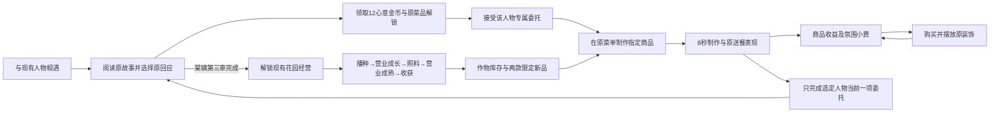
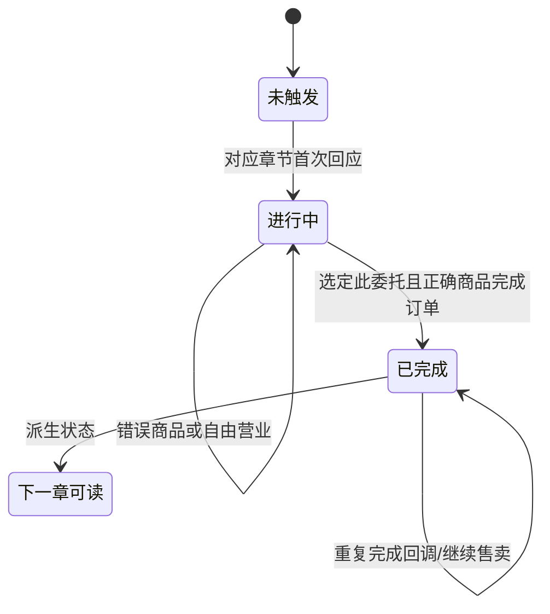
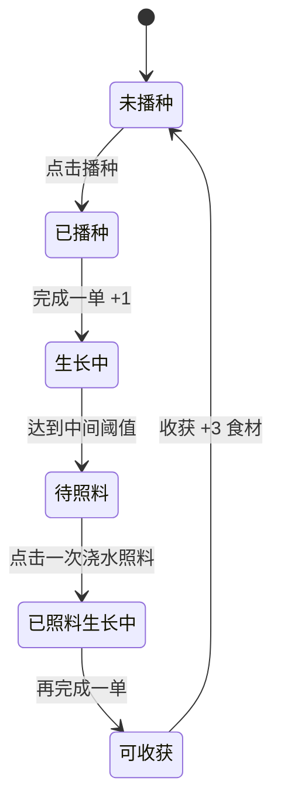

# 《玻璃间》核心玩法闭环长期产品规格

版本：1.3 · 2026-11-16（阶段3经营经济与目标引导）  
状态：阶段1人物委托、阶段2花园/库存/限定饮品已完成；阶段3经营经济与目标引导已完成并验收通过；本地构建，未发布。  
项目：`输出/玻璃间-庭院天气版`；实际源码：`app/src/`；生产产物：`game/`。  
配套执行计划：[GAMEPLAY-CLOSURE-PLAN.md](GAMEPLAY-CLOSURE-PLAN.md)。

本文件整理用户本次提供的完整策划需求，作为后续迭代的长期约束。最初 P0 仅审计与规划；当前按后续授权实施阶段3经营经济与目标引导。只有执行计划顶部列出的阶段1、阶段2、阶段3范围已实现，长期规格中的其他能力不代表已实现或上线。后续变更应更新本文件的决策记录，不能用实现便利覆盖锁定要求。

> 阶段2历史范围声明：本轮授权新增 gardenUnlocked、gardenState、ingredients、gardenRecipes；棠姨第三章解锁，两单成长→浇水→再一单成熟，每次收获3份，完成新品订单时消耗1份食材。保留阶段1委托、原九章和原四款菜单/六件装饰，仅在菜单末尾追加两款饮品。该阶段结束时氛围小费未实施，现已由阶段3补齐。

> 阶段3范围声明：新增装饰氛围小费与目标提示完善；小费按完成时六件已购买且摆放的常规装饰计算，上限6。收益、委托和作物状态变化合并通知，关键通知按序显示。旧存档不新增字段、不补发旧单小费；原价格、12金币、菜单结构与作物规则保持。

## 1. 目标与范围

核心主题：**每一杯咖啡推动一次相遇；每一次相遇，为小店留下新的味道。**

利用已完成的人物、对话、菜单、订单、装饰、花园、葡萄、草莓与存档系统，形成清晰、温暖、无惩罚的经营循环。此次是最小增量迭代，不推翻、不重做、不大规模重构。



错误商品仍正常售卖、获得收益、推动已播种作物成长，只是不完成人物委托。玩家可随时自由营业，不必推进剧情。原有四款商品永远不受花园食材限制。

## 2. 当前系统基线（源码事实）

依据审计时的本地源码，不以旧截图、线上地址或历史测试报告代替当前事实。

| 范围 | 当前行为 | 本次增量边界 |
|---|---|---|
| 工具链 | Three.js `0.187.0`，TypeScript `7.0.2`，Vite `8.3.8`；无框架、无后端 | 不更换工具链 |
| 入口 | Vite `root: app`、`base: ./`、输出 `../game`；TS 仅包含 `app/src` | 根目录旧 `src/` 不实施新功能 |
| 人物 | `game.ts` 内三人各三章；回应后章节 +1、coins/earned 各 +12、解锁原配方 | 原故事常量逐字锁定 |
| 章节门槛 | 已读章数为 n 时，`n > 0 && served < n` 阻止下一章；同一全局 served 被三人共用 | 替换为每人每阶段的指定委托门槛 |
| 对话组件 | `dialogue.ts` 管分页、自动、跳过、归档与回应一次性提交；跳过不自动领奖 | 保持组件及移动端表现；门槛辅助提示由调用端提供 |
| 订单 | 一个运行时 pending 商品；`main.ts` 启动 8 秒制作，结束调用 `game.complete()` | 增加订单目标和原子结算，不改时长与动画架构 |
| 收益 | 订单加商品价格到 coins/earned，served +1；没有氛围小费 | 增加最多 6 枚小费 |
| 送餐 | `world.ts`/`delivery.ts` 的服务员路线与制作视觉已存在；没有委托 NPC 标识回传 | 使用原完成事件做逻辑交付，不改路线或等待一整轮路线 |
| 花园 | `garden.ts` 为现有花园、棠姨、猫和道具；花园热点只有提示，没有经营状态 | 复用现有区域，不移动或重建 |
| 果实 | `garden-fruit.ts` 的葡萄、草莓与落果共用 berries 显隐组，按天气切换；天气缓存可能提前返回 | 分离两种作物的成熟果实表现，并增加事件驱动刷新 |
| 存档 | `glasshouse-stories-v1`；7 个核心字段；导出包装 `glasshouse-v1` | 原 key/包装保留，添加可选字段 |
| 导入 | 校验旧 7 字段；只在读文件前检查制作状态 | 兼容新字段，并在异步读取后再次检查订单状态 |
| 引导 | 先阿禾首章、首单、首件装饰，再泛指故事；文案与点击动作分别判断 | 改为同一纯规则返回目标和动作 |

## 3. 锁定内容与明确非目标

### 3.1 不得删除、改写、降级或替换

1. 阿禾、林伯、棠姨全部原始故事、原回应、三章顺序、故事归档；正文和回应见附录 A。
2. 对话自动翻页、跳过、返回/关闭、移动端分页与布局；未回应不得领奖，归档阅读不得重复领奖。
3. 四款原商品的名称、售价、图片、基础解锁来源与顺序。
4. 六件原付费装饰的名称、价格、图片、购买、摆放、收起逻辑。
5. 庭院、店内、海岛、花园位置、人物造型、天气/雨雪、昼夜、留影、音乐、镜头、坐下、自由环视和缩放等既有系统。
6. 8 秒订单制作、咖啡师动画、服务员送餐和收益反馈的既有能力。只扩展反馈内容，不重做制作小游戏。
7. 本地自动存档、导出与恢复；已领取奖励不重发，已有进度不倒退。
8. 既有美术风格、花园草坪、葡萄藤、草莓植株、落果、棠姨与猫。经营状态只调整成熟果实显隐。

### 3.2 原商品锁定表

| ID | 名称 | 售价 | 当前图片索引 | 基础解锁来源 | 作物消耗 |
|---|---|---:|---:|---|---|
| pour | 今日手冲 | 24 | 2 | 初始拥有 | 无 |
| honey | 蜂蜜拿铁 | 32 | 0 | 阿禾第一章回应后 | 无 |
| berry | 莓果可颂 | 38 | 12 | 林伯第二章回应后 | 无 |
| tea | 薄荷花园茶 | 28 | 3 | 阿禾第二章或棠姨第二章回应后 | 无 |

解锁仍发生在原故事回应时，不挪到委托完成时。莓果可颂不改名、不改配方归属、不收费食材。

### 3.3 原付费装饰锁定表

| ID | 名称 | 价格 | 图片索引 | 当前源码摆放标签 |
|---|---|---:|---:|---|
| flowers | 庭院花箱 | 55 | 3 | 庭院 |
| rug | 鼠尾草地毯 | 75 | 6 | 店内 |
| lamp | 黄铜阅读灯 | 95 | 2 | 店内 |
| gramophone | 老式唱片机 | 135 | 7 | 店内 |
| lantern | 玻璃花园灯 | 110 | 8 | 庭院 |
| art | 植物挂画 | 85 | 5 | 店内 |

以上按本次实际源码记录，包括唱片机的「店内」标签；不根据历史概念图擅自改动。冬日免费陈设继续使用原有独立能力，不计氛围小费。

### 3.4 非目标

不新增 NPC、大型 3D 场景、新花园、框架、后端或强制登录；不加入体力、失败倒计时、真实时间等待、枯萎、破产、第二种货币、复杂评分系统；不重构镜头、天气、水面、雪景、室内渲染架构；不调整已确认布局；不追改历史需求。P0 不构建；阶段1和阶段2仅运行本地生产构建更新 `game/`，不发布、推送或部署。

## 4. 状态模型与职责边界

所有经营状态必须可 JSON 序列化。Three.js 对象、DOM、定时器、事件监听器、材质与坐标锚点不得写入存档。以下是建议的数据契约，名称可在实施前细化，业务含义不可改变。

```ts
type CharacterId = 'ahe' | 'lin' | 'tang';
type QuestId = 'ahe-1' | 'ahe-2' | 'lin-1' | 'lin-2' | 'tang-1' | 'tang-2';
type CropId = 'grape' | 'strawberry';
type GardenRecipeId = 'strawberry-oat-latte' | 'grape-sparkling-americano';
type CropState = {
  stage: 'unsown' | 'sown' | 'growing' | 'needs-care' | 'ready';
  growth: number;       // 建议 0..3，阈值待确认
  cared: boolean;
  everHarvested: boolean;
};
type ProgressionExtension = {
  characterQuests?: {
    version: 1;
    entries: Partial<Record<QuestId, {
      status: 'active' | 'completed';
      completion?: 'order' | 'legacy';
    }>>;
    legacyGateCredits: QuestId[]; // 尚未读到的旧门槛豁免，不提前发故事奖励
  };
  gardenUnlocked?: boolean;
  gardenState?: {
    seedsIntroduced: boolean;
    crops: Record<CropId, CropState>;
  };
  ingredients?: Record<CropId, number>;
  gardenRecipes?: GardenRecipeId[];
};
// 原 CafeSave 的 coins/earned/chapters/recipes/owned/placed/served 全部保留。
// 新存档 = 原 CafeSave & ProgressionExtension；原 recipes 不混入花园配方 ID。
```

未触发的普通委托不必存一条 inactive 记录；由章节和委托定义推导。界面状态、徽签、可读章节、氛围小费、果实显隐均为派生值，不额外保存互相矛盾的副本。

运行时订单建议为 `{id, recipeId, targetQuestId?, status}`，不持久化进行中的订单，延续刷新后制作中止的当前行为。可复用 pending 的单订单限制，不引入任务队列。

| 模块 | 应承担 | 不应承担 |
|---|---|---|
| 新 `progression.ts` | 纯数据迁移、章节/委托规则、作物转换、库存、订单结算、引导选择 | DOM、Three.js、音频、帧循环 |
| `game.ts` | 菜单/人物/花园面板、调用规则、保存/导入导出、收益提示 | 3D 造景或镜头逻辑 |
| `garden.ts`、`garden-fruit.ts` | 现有模型、两类果实显隐、当地热点/锚点、天气表现 | 库存、奖励、订单计数、存档 |
| `main.ts` | 连接 3D 热点、UI 与现有订单完成事件；传递派生视觉快照 | 在动画循环中推进章节或作物 |
| `dialogue.ts`、`world.ts` 等锁定模块 | 原有职责保持 | 为新经营规则重构 |

## 5. 人物专属委托

### 5.1 委托定义与章节门槛

| 委托 ID | 触发故事 | 原回应后解锁 | 本次目标 | 完成后可读 |
|---|---|---|---|---|
| ahe-1 | 阿禾①《第一杯的温度》 | 蜂蜜拿铁 | 制作并交付 1 份蜂蜜拿铁 | 阿禾②《留一盏灯》 |
| ahe-2 | 阿禾②《留一盏灯》 | 薄荷花园茶 | 制作并交付 1 份薄荷花园茶 | 阿禾③《写在菜单背面》 |
| lin-1 | 林伯①《靠窗的老座位》 | 无 | 制作并交付 1 份今日手冲 | 林伯②《口袋里的种子》 |
| lin-2 | 林伯②《口袋里的种子》 | 莓果可颂 | 制作并交付 1 份莓果可颂 | 林伯③《潮水会回来》 |
| tang-1 | 棠姨①《把雨水留下》 | 无 | 制作并交付 1 份今日手冲 | 棠姨②《春天的信》 |
| tang-2 | 棠姨②《春天的信》 | 薄荷花园茶 | 制作并交付 1 份薄荷花园茶 | 棠姨③《小小的花园》 |
| 无新委托 | 棠姨③《小小的花园》 | 原回应保留 | 完成人物线 | 花园经营权限 |

所有章节回应仍正常发放原有 12 枚心意金币。委托完成后开放下一章，不代替玩家阅读、回应或自动领取该章奖励。阿禾、林伯第三章仍按原规则收录，不增写第四章。



迁移豁免可让未触发的门槛在对应章节回应后直接成为已完成，标记 `completion: legacy`；不得因此发额外金币或虚构订单。正常新玩家不使用 served 判断任何章节门槛。

### 5.2 同商品多人委托：阶段1采用的 D1 规则

最多三项活跃委托，每人最多一项。今日手冲可能同时来自林伯与棠姨，薄荷茶可能同时来自阿禾与棠姨；一次订单绝不能顺便完成两人委托。

建议：菜单顶部三条委托可点选，明确显示当前交付对象，并预选目标商品；同商品仅有一个可完成委托时默认匹配该对象，同商品有多个委托时要求选一个对象，或明确选择自由营业。点击其他商品仍可制作，属于普通售卖，不惩罚、不完成原委托。下单时冻结 `targetQuestId`，8 秒内新读章节或切换菜单不得重新定向本单。

完成判断同时满足：目标 ID 存在、处于 active、属于当前阶段、订单商品与目标相同。只更新这个 ID。单独看商品 ID 或全局 served 均不够。

完成反馈：`阿禾的委托已完成 · 新的故事可以继续了`。需求没有定义额外委托奖金；建议不另发奖金，只保留故事 12 金币、商品收入和氛围小费（D3）。同项委托只完成一次，不重发任何关联奖励。

### 5.3 人物卡与菜单状态

| 人物卡状态 | 条件 | 点击结果 |
|---|---|---|
| 有新故事 | 首章未读，或下一章可读且无须展示刚完成提示 | 原对话组件打开该章 |
| 委托进行中 | 当前门槛委托 active | 明确目标，提供菜单入口 |
| 委托已完成，可继续故事 | 对应门槛 completed，下一章尚未回应 | 打开原下一章 |
| 故事已收藏 | 该人物已读 3 章 | 原故事归档 |

锁定提示必须是真条件，例如 `为林伯完成一份今日手冲后继续`。替换现有「接待一单」辅助引导，不触碰原故事正文和回应。

菜单仅轻量扩展：顶部最多三项委托，原卡片增加 `人物委托 · 阿禾` 小标签；多位对象的标签完整可辨，不能随机隐藏目标。仍使用现有菜单、制作按钮和原商品图片，不新增独立接单系统。

## 6. 花园经营支线

### 6.1 开放与入口

棠姨第三章正式回应前，花园保持可见景观，不可播种、照料、收获；入口隐藏，模型点击也不能绕过权限。完成第三章后增加「花园」导航，现有葡萄藤、草莓区域点击热点打开同一个花园面板。UI 和规则层都检查权限。

第一次进入，显示棠姨留下葡萄、草莓种子的简短系统说明，不插入或改写人物原对白，不增加种子货币和付费种子。`seedsIntroduced` 只控制说明出现一次；后续可无限次免费重新播种。

沿用花园实际位置及变换。当前花园根节点有旋转和平移，热点必须从局部模型锚点变换到世界坐标，不照旧文本里的「右侧」硬编码。

### 6.2 两种作物共用的轻量状态机



「已照料生长中」在数据上仍是 growing，`cared=true`，不是第六种持久化 stage。阈值未在原需求中给出，建议每轮总共三单（D2）：

| 状态 | growth/cared 建议值 | 有效操作 | 完成订单的效果 |
|---|---|---|---|
| 未播种 | 0/false | 播种 | 无 |
| 已播种 | 0/false | 去营业 | +1 → 生长中 |
| 生长中，未照料 | 1/false | 去营业 | +1 → 待照料 |
| 待照料 | 2/false | 浇水照料一次 | 停在此处，不储存跳关点数 |
| 生长中，已照料 | 2/true | 去营业 | +1 → 可收获 |
| 可收获 | 3/true | 收获 | 保持成熟，不重复叠产量 |

每个正常完成的咖啡店订单同时作用于所有已播种作物，包含错误委托商品、普通订单和限定新品。未完成/重复回调、故事奖励、购买装饰、天气变化均不推动生长。通过照料关卡后必须再做一单；不能先囤很多订单再浇水直接收获。

收获事务：只允许 ready → 对应食材 +3 → 标记首次收获 → 解锁对应新品（一次）→ 该作物恢复 unsown。重复点击/回调不再加食材。葡萄与草莓互不阻塞。没有枯萎、真实时间等待、每日重置和季节损失。

### 6.3 模型与天气表现

不创建新花园，不改植物、道具、草坪、角色位置。经营开放前保持当前景观果实；开放后，两类成熟果实分别按 ready 显示，未成熟隐藏成熟果实并保留藤叶/植株。两种落果跟随所属作物的成熟表现，不直接作为可拾取的免费食材，以免绕过经营循环。

冬季继续当前休眠视觉；状态、库存、照料、订单生长与收获资格保留，面板仍可操作，天气切回不会重置。先天气后经营同步或反向同步都必须得到相同可见结果，不能因 `garden-fruit.ts` 的天气缓存不变而忽略作物更新。

只增加两种果实分组和两个交互锚点；模型的单次重新合批不改变造型。每帧只做原有天气/风动画，经营事件发生后才推送视觉状态。

## 7. 花园限定新品、订单事务与装饰收益

### 7.1 原菜单之后追加两款

| 建议 ID | 名称 | 售价 | 永久解锁条件 | 每份消耗 |
|---|---|---:|---|---|
| strawberry-oat-latte | 草莓燕麦拿铁 | 42 | 首次收获草莓 | 草莓 1 |
| grape-sparkling-americano | 葡萄气泡美式 | 46 | 首次收获葡萄 | 葡萄 1 |

库存单独展示；缺货不取消已获得的配方。未解锁显示收获来源，已解锁但库存为 0 时禁用并显示 `去花园收获草莓后可以继续制作。`（葡萄对应替换）。新品卡沿用原视觉语言，优先复用现有图集内匹配饮品/水果元素，不修改四款原图，不启动大型美术制作。

### 7.2 一单只提交一次

建议按订单完成时扣食材、按完成时已摆放装饰计算小费（D3）。原因：当前 pending 不存档，开始即扣料会使刷新中止的订单白白损失作物。

开始时检查：无 pending、商品已解锁、库存足够；必要时选定委托对象。记录商品与目标，进入原 8 秒制作。制作中禁止导入覆盖进度；文件读取结束时再次检查，避免异步导入与下单竞争。切换场景、天气、菜单不替换订单对象。

完成时用同一个纯数据事务：

1. 验证订单尚未提交、当前配方/库存合法；失败不写入部分状态、不产生负库存。
2. 限定新品扣对应库存 1，原四款不扣任何作物。
3. 计算商品收益与氛围小费，coins/earned 增加其和，served +1。
4. 至多完成冻结目标中的一项有效委托。
5. 两种作物各接受一次订单完成事件；原本需要照料的仍停在照料关卡。
6. 一次更新可序列化状态与存档，然后刷新人物卡、菜单、引导、果实表现、钱包和反馈。
7. 标记订单已提交并清空 pending；再次收到相同完成事件是空操作。

持久化失败沿用现有提示：本次内存进度可继续，但不声称保存成功。业务上的「一次」通过同步事务和订单状态保证；本期不做跨标签页云同步或防作弊系统。

### 7.3 氛围小费

`tip = min(6, 六件常规装饰中同时 owned 且 placed 的不同 ID 数量)`。

购买但收起不加成，收起后下一单对应加成取消，冬季免费陈设不加成，重复 ID 不多算。只在正常订单完成时加小费，不追溯旧单、不作用于故事心意金币。

反馈分项显示：`商品收益 +32 · 氛围小费 +3`。同次委托完成反馈排队或合并为独立可读第二行，不能被下一条 toast 覆盖。沿用原收益提示容器，不增加占据场景的大面板。

## 8. 引导、移动端与节奏

### 8.1 「下一件小事」

同一规则函数同时返回文案与动作，优先级严格按需求：

1. 尚未阅读且当前可读的新章节。
2. 当前人物委托（指向明确人物/商品）。
3. 首件装饰：有足够金币去装扮；不足则自由营业攒金币。
4. 棠姨人物线（花园尚未开放的目标说明；可读/委托通常已由前两项覆盖）。
5. 花园收获、照料、播种；全部在成长则提示完成订单，不能导向无操作空面板。
6. 自由经营。

同优先级建议阿禾→林伯→棠姨固定排序，避免刷新跳动。若产品希望更早推荐棠姨或装饰，必须调整明确优先级，不暗改算法。花园内部建议可收获→待照料→未播种→继续营业。

### 8.2 390px 适配

保留原面板骨架、对话水彩头像、自动/跳过按钮与触控环视。新增委托条可换行，菜单仍两列，花园卡在窄屏一列；文本不遮价格/按钮。新增花园导航只在解锁后出现，沿用现有导航布局，测量其与天气、人物侧栏、制作进度及场景热点不相交。面板打开时点击/拖动不能穿透到 3D；关闭与 Escape 恢复操作。禁止新增全屏常驻 HUD。

### 8.3 新玩家目标节奏

| 目标时间 | 体验 |
|---|---|
| 0—3 分钟 | 与阿禾交谈，蜂蜜拿铁及首委托开放 |
| 3—6 分钟 | 制作蜂蜜拿铁，理解正确商品→委托完成→新故事 |
| 6—12 分钟 | 自由选择林伯或棠姨线，积累金币 |
| 12—18 分钟 | 第一件装饰，理解收益→布置→氛围小费 |
| 18—25 分钟 | 棠姨第三章，花园开放 |
| 25—30 分钟 | 播种、营业成长、照料、收获、限定新品 |

这是体验目标，不是强制等待。现有短对白与每单 8 秒允许熟悉玩家明显更快完成；不得为了凑 30 分钟新增硬门槛、等待或减慢已有动画。以真实试玩验证引导可理解性（D4）。

## 9. 存档兼容与迁移

### 9.1 格式与原则

继续读写 `glasshouse-stories-v1`，导出继续 `{format: 'glasshouse-v1', save}`。五个新增顶层字段均可缺失。旧核心七字段对合法旧存档逐值保留，保留数组内容和顺序，不重新计算 earned，不从 served 补钱，不从章节重发奖励。

原 recipes 只存原四款；新品使用 gardenRecipes。原 owned/placed 不纳入冬季陈设。已有冬日独立保存逻辑不迁移、不扩张导出边界。

先构造迁移候选对象并通过验证，再一次替换运行状态。导入失败当前存档不变。缺少/损坏某个新增字段只在该字段采用安全值，不因新增字段问题清空整个有效旧存档。基础字段仍保留现有有效性校验，不接受负金币等非法导出文件。

### 9.2 旧章节资格的推断

对每个人，令 `c=已回应的章节数`、`s=旧 served`，第一项委托对应 chapter 1→2，第二项对应 chapter 2→3：

- 第一门槛已满足：`c >= 2 || s >= 1`。
- 第二门槛已满足：`c >= 3 || s >= 2`。
- 已经读过的章节优先于其他数据，不能倒退。
- 门槛满足但触发章节还未回应：记录 future `legacyGateCredits`，不提前增章节、不激活可领奖 UI。
- 触发章已回应且门槛未满足：生成该人物当前 active 委托。
- 委托已属于更早章节：完成记录只作为历史，不再次发奖。

| 旧 c / s（单个人物） | 第一门槛 | 第二门槛 | 迁移后读法 |
|---|---|---|---|
| 0 / 0 | 未满足 | 未满足 | 新流程，首章开放 |
| 0 / 1 | 未来豁免 | 未满足 | 回应首章后第二章仍可读 |
| 0 / 2 或更多 | 未来豁免 | 未来豁免 | 顺序回应后可读全部三章；不凭空收录 |
| 1 / 0 | active | 未满足 | 完成第一项专属委托 |
| 1 / 1 | completed legacy | 未满足 | 第二章继续开放 |
| 1 / 2 | completed legacy | 未来豁免 | 第二章回应后第三章仍开放 |
| 2 / 0 或 1 | completed legacy（章节证据） | active | 不撤回第二章，第三章需当前委托 |
| 2 / 2 | completed legacy | completed legacy | 第三章继续开放 |
| 3 / 任意 | completed legacy | completed legacy | 原归档，无重复奖励 |

必须保存尚未触发的豁免，否则 `c=0,s=2` 的旧玩家读完首章会突然被新门槛锁住。迁移后写入 `characterQuests.version=1`；此后新产生的 served 只作统计，不再推断委托。迁移是幂等的，反复加载/导入同一文件不叠加任何奖励。

判别建议：新游戏无旧对象则初始化；旧对象缺少 characterQuests 时做一次上述迁移，即使其他新增字段已存在也逐字段保留。characterQuests 已存在时视为扩展存档，优先保留有效 entries/豁免，缺项按章节事实和安全默认补齐，不再次用 served 全量放行。无法识别的未来 schema 不静默覆盖有效进度，应给出可恢复的格式提示。

### 9.3 新字段默认值与一致性

| 字段 | 缺失默认/修复 |
|---|---|
| characterQuests | 按上节迁移；新游戏为空 entries/credits；保留已完成证据 |
| gardenUnlocked | `chapters[2] >= 3` 自动 true；开放权限不得绕过棠姨第三章 |
| gardenState | 两种未播种、growth 0、cared/everHarvested false，说明未显示；有效作物记录逐项保留 |
| ingredients | 葡萄/草莓各 0；只接受安全非负整数，单项无效不影响另一项和核心字段 |
| gardenRecipes | 默认空；保留有效新品 ID；有效 everHarvested 可恢复对应解锁 |

章节完成但 gardenUnlocked=false 时修复为 true；反向不一致的显式 true 不能绕过人物线，但保留已有作物和库存数据，待真正解锁后可继续，不销毁资源。作物 stage/growth/cared 需共同校验，不能将一个 ready 作物在读档时擅自收获。已解锁新品不因库存耗尽重新锁定。

读档/导入/导出必须使用同一数据规范化契约；导出当前扩展数据而非只挑旧七字段。对合法旧数据不做额外排序、去重或静默丢字段；运行时小费计算用去重后的派生集合即可。

## 10. 完整新玩家操作路径（验收脚本）

1. 干净存档进入，默认今日手冲可用，花园只可看；与阿禾阅读第一章并原回应，得 12 金币、蜂蜜拿铁、阿禾委托。
2. 先做今日手冲：8 秒后得 24 金币，阿禾委托仍 active。再选阿禾委托做蜂蜜拿铁：8 秒后得 32 金币，仅 ahe-1 完成，出现继续故事提示。
3. 阅读阿禾第二章，得原 12 金币与茶；制作茶完成 ahe-2，再阅读原第三章、归档。
4. 林伯第一章回应→手冲委托→第二章回应解锁莓果可颂→可颂委托→第三章归档。棠姨第一章回应→指定棠姨的手冲委托→第二章回应解锁茶→指定棠姨的茶委托→第三章回应开放花园。
5. 收益足够时购买庭院花箱 55 金币；再卖蜂蜜拿铁反馈 `商品收益 +32 · 氛围小费 +1`；收起后再卖小费回到 0。
6. 花园首进说明后，两种作物各点播种；按建议三单阈值，第一单 growing、第二单 needs-care；额外做单不越过照料；分别浇水，再完成一单，两种都 ready。
7. 收获草莓 +3、葡萄 +3；各解锁新品，成熟果实对应隐藏，允许再次播种。点同一收获动作第二次不增加库存。
8. 制作草莓燕麦拿铁一次，库存 3→2，获得 42 +当前小费；葡萄新品同理 46。耗尽草莓后草莓新品禁用且指向收获，原四款照常营业。雪天操作不丢作物或库存。
9. 导出、刷新、恢复，章节/委托/作物/食材/新品/装饰一致；故事归档不发奖励。全程天气、室内、坐下、音乐、镜头、留影可继续使用。

同款商品多委托场景需另用测试存档同时激活，确保一单不完成所有人物；上述顺序路径不能替代该验收。

## 11. 验收清单（必须全部满足）

| ID | 必须验证 |
|---|---|
| A01 | 三位人物九章原始标题、正文、回应逐字一致，章节顺序与原解锁来源一致 |
| A02 | 原四款菜单及六件付费装饰的名称、价格、图片、基础逻辑保持 |
| A03 | 任意订单不再通过 served 自动推进三人故事 |
| A04 | 错误商品只有正常经营收益/作物成长，不完成委托、不判失败 |
| A05 | 正确商品只完成指定人物当前一项委托，重复回调无重复奖励 |
| A06 | 棠姨第三章完成前导航/热点/规则均不能经营花园 |
| A07 | 两种作物独立完成可重复播种、成长、照料、收获；不受真实时间和冬季损失影响 |
| A08 | 首次收获分别永久解锁对应两款新品 |
| A09 | 新品准确扣 1 食材，原四款零消耗，缺货禁用，库存不为负 |
| A10 | owned∩placed 的常规装饰产生 0—6 小费；收起取消，冬季免费不计 |
| A11 | 旧本地存档/旧导出/新导出兼容，七字段不丢、旧阅读资格保留、幂等迁移 |
| A12 | 对话自动、跳过、回应一次、归档、关闭、390px 布局不回归 |
| A13 | 天气、昼夜、海岛、室内、坐下、音乐、送餐、留影、自由环视不回归 |
| A14 | 无浏览器错误、负库存、重复结算/收获/章奖励；面板点击不穿透 |
| A15 | TypeScript 检查、生产构建、核心流程自动化全部通过；测试命令与证据可复现 |

测试分层、阶段文件及具体命令见执行计划。本阶段只阅读既有测试，没有运行会写存档或输出图片的浏览器测试，没有生产构建，不将历史结果当作本次通过证据。

## 12. 待确认产品决策

| ID | 未明确之处 | 推荐方案 | 影响 |
|---|---|---|---|
| D1 | 同一商品被多人委托时交付给谁 | 单对象时默认匹配，多对象从委托条选一人；可明确自由营业；目标下单冻结 | 一单只完成一项，反馈归属明确 |
| D2 | 作物中间阶段需要几单 | 播种后第 1 单生长、第 2 单待照料；浇水后第 3 单成熟；待照料不囤成长点 | 每轮有完整营业—照料—营业循环 |
| D3 | 委托额外奖、扣料时点、小费时点 | 不另设委托金币；完成订单才扣料；小费按完成时摆放状态 | 延续原经济，刷新中止不白扣食材 |
| D4 | 30 分钟节奏是否是硬要求 | 作为试玩目标，允许熟悉玩家更快完成，不新增等待或章数门槛 | 与保留 8 秒订单及无高压机制一致 |

以上是建议，不等于用户已确认。花园解锁前保留景观成熟果实、解锁后落果跟随成熟状态属于最小视觉方案；如需落果拾取玩法，需另立需求，不能夹带实施。

## 附录 A：九章原文冻结清单

以下摘自本次审计的 `app/src/game.ts`。标点、回应、解锁值都属于锁定内容。

### 阿禾 · 咖啡师

1. **第一杯的温度**
   - 正文：我以前总想把每杯咖啡做得一模一样。后来才发现，人每天需要的温度都不同。你愿意替我试试新配方吗？
   - 回应：当然，慢慢试。
   - 原解锁：honey
2. **留一盏灯**
   - 正文：这间温室是父亲留下的。他说，下雨的人需要一个能看见天空的地方。我想把这盏灯一直留着。
   - 回应：我会一起照顾这间小店。
   - 原解锁：tea
3. **写在菜单背面**
   - 正文：今天有人说，这里的咖啡像回家。那是我收到过最好的评价。下一杯，也请你帮忙。
   - 回应：那就继续开门吧。
   - 原解锁：空

### 林伯 · 常客 · 修船匠

1. **靠窗的老座位**
   - 正文：年轻时我修了很多船，却很少坐船出海。现在最喜欢的旅途，是每天走到这里的这一小段路。
   - 回应：今天也替你留着窗边。
   - 原解锁：空
2. **口袋里的种子**
   - 正文：我妻子以前喜欢蓝莓。我把她种的那一小盒带来了，也许能做成一道点心，让更多人尝到。
   - 回应：让它成为店里的新点心吧。
   - 原解锁：berry
3. **潮水会回来**
   - 正文：那张靠窗的椅子修好了。我在椅背刻了一片小叶子，她一定会喜欢。谢谢你肯听这些旧事。
   - 回应：旧故事，也值得好好收藏。
   - 原解锁：空

### 棠姨 · 常客 · 花园照料人

1. **把雨水留下**
   - 正文：别急着给植物浇水，先摸摸泥土。照顾人也是一样，先听一听，再决定给他什么。
   - 回应：我想听听你的花园。
   - 原解锁：空
2. **春天的信**
   - 正文：我把薄荷和蜂蜜一起泡茶，就像春天寄来的一封信。你也试试，把香气留在杯子里。
   - 回应：把这封信写进菜单吧。
   - 原解锁：tea
3. **小小的花园**
   - 正文：今天的花开了。院子不需要很大，能容下一把椅子和一个愿意坐下的人，就很好。
   - 回应：给我们的庭院再添一点绿。
   - 原解锁：空；本迭代仅追加花园权限

## 后续授权：仓库（2026-11-17）

按本轮用户请求增加作物/餐品/装饰仓库，替换主页花园按钮，保留作物热点和观察机位。复用 ingredients 与 owned/placed，仅新增 foodStock。原制作并售出仍为默认；明确选择自由营业后可制作入库。入库不发收益、不推进 served/委托/作物；后续库存出售按原售价与出售时氛围小费结算，不再扣食材、不推进上述事件。旧档餐品为空，不回填历史订单。完整规则与证据见 [WAREHOUSE-IMPLEMENTATION.md](WAREHOUSE-IMPLEMENTATION.md)。这是本轮明确授权的独立增量，不改变已完成三个阶段的历史验收记录。
